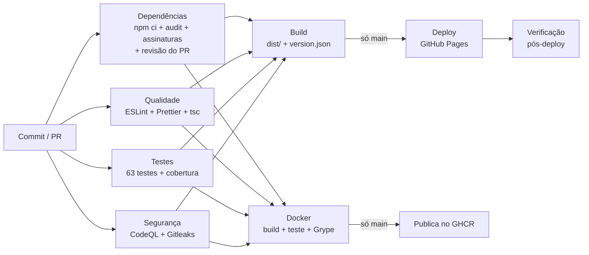

# SimulaFinanças

[](https://github.com/PedroKuhn1/simula-financas/actions/workflows/ci.yml)
[](https://github.com/PedroKuhn1/simula-financas/actions/workflows/monitor.yml)
[](https://github.com/PedroKuhn1/simula-financas/releases)
[](LICENSE)

Simuladores financeiros gratuitos: juros compostos, financiamento (SAC × Price) e reserva de emergência.
É uma SPA desenvolvida como trabalho final da disciplina de **Integração Contínua**.

| Entrega             | Link                                          |
| ------------------- | --------------------------------------------- |
| Repositório         | https://github.com/PedroKuhn1/simula-financas |
| Aplicação publicada | https://pedrokuhn1.github.io/simula-financas/ |
| Imagem Docker       | `ghcr.io/pedrokuhn1/simula-financas:latest`   |

---

## 1. Sobre o projeto

O SimulaFinanças responde, em segundos e sem cadastro, a perguntas financeiras comuns:

- "Quanto vou ter se investir R$ 500 por mês?"
- "Qual sistema de financiamento sai mais barato?"
- "De quanto deveria ser a minha reserva de emergência?"

Todo o cálculo é feito no navegador. Nenhum dado digitado é enviado a servidor algum.

O foco do trabalho é o **processo de entrega**, mais do que a aplicação em si. Cada mudança passa pelos mesmos passos
antes de chegar ao ar, todos automáticos:

**Pull request → pipeline (qualidade, testes, segurança) → build → deploy → verificação**

Depois do deploy, um monitoramento agendado confere se o site continua no ar.

## 2. Serviço proposto

**Problema.** Simuladores bons costumam estar escondidos atrás de cadastro, ou dentro de sites de bancos que querem
vender um produto. Entre os simuladores neutros, muitos são confusos no celular.

**Proposta.** Uma ferramenta neutra, rápida e responsiva, com explicações em linguagem simples.

**Público.** Pessoas organizando a vida financeira, estudantes e quem está comparando propostas de financiamento.

**Potencial de receita.** O layout reserva **espaços de anúncio** (componente `AdSlot`) no topo e ao lado dos
resultados. São páginas com intenção de busca alta, como "simulador de financiamento" e "calculadora de juros
compostos", e por isso têm bom valor para anúncios contextuais e parcerias (corretoras e comparadores de crédito).
Os espaços ficam visíveis como placeholders e não carregam scripts de terceiros. Isso também mantém a
Content-Security-Policy rígida.

## 3. Funcionalidades

| Simulador                     | O que faz                                                                                                                                                                             |
| ----------------------------- | ------------------------------------------------------------------------------------------------------------------------------------------------------------------------------------- |
| **Juros compostos**           | Valor inicial + aporte mensal + taxa anual + prazo. Mostra o saldo final, o total investido, o total de juros e a evolução ano a ano.                                                 |
| **Financiamento SAC × Price** | Calcula as duas tabelas de amortização, compara a primeira e a última parcela e o total de juros, e indica qual sai mais barato. Tabela completa mês a mês.                           |
| **Reserva de emergência**     | Recomenda de 3 a 12 meses de despesas conforme a estabilidade da renda (servidor público, CLT ou autônomo). Mostra quanto falta, o progresso e em quanto tempo a reserva fica pronta. |

Outros detalhes:

- **Entrada de valores flexível:** aceita `1.234,56` e `1234.56`.
- **Validação com mensagens claras:** valores negativos e prazos fora de 1 a 600 meses são recusados com uma
  mensagem explicando o motivo.
- **Taxas tratadas corretamente:** a taxa anual vira a taxa mensal equivalente por `(1 + a)^(1/12) − 1`, sem dividir
  por 12.
- **Navegação:** rotas com `HashRouter`, então recarregar a página no GitHub Pages não dá 404. Há uma página 404
  própria.
- **Layout responsivo:** no celular, as tabelas rolam dentro do próprio card.
- **Versão no rodapé:** o rodapé mostra a versão publicada, e `/version.json` informa a versão e o commit que estão
  no ar.

## 4. Tecnologias utilizadas

| Área       | Ferramenta                                                                                | Por quê                                                      |
| ---------- | ----------------------------------------------------------------------------------------- | ------------------------------------------------------------ |
| Aplicação  | React 19, TypeScript 6, React Router 7                                                    | Componentes, tipagem estrita, rotas de SPA                   |
| Build      | Vite 8                                                                                    | Build rápido, saída estática pronta para CDN                 |
| Testes     | Vitest, Testing Library, jsdom, coverage-v8                                               | Testes unitários e de interface no mesmo runner do build     |
| Qualidade  | ESLint 10 (typescript-eslint _strict_, sonarjs, react-hooks), Prettier, `tsc`             | Lint com regras de tipo, complexidade cognitiva e formatação |
| Segurança  | CodeQL, Gitleaks, npm audit, `npm audit signatures`, Dependency Review, Dependabot, Grype | SAST, segredos, dependências, cadeia de suprimentos e imagem |
| CI/CD      | GitHub Actions                                                                            | Pipeline, release, monitoramento                             |
| Hospedagem | GitHub Pages                                                                              | Gratuito, HTTPS, deploy por OIDC (sem token salvo)           |
| Container  | Docker (multi-stage), nginx-unprivileged, GHCR                                            | Imagem pequena, sem root, publicada no registry do GitHub    |

## 5. Arquitetura da aplicação

```text
src/
├── lib/finance.ts        ← regras de negócio: funções puras, sem React e sem DOM
├── components/           ← peças de interface reutilizáveis (campo numérico, cartão, tabela, AdSlot…)
├── pages/                ← uma página por simulador + Home + 404
├── App.tsx               ← rotas (HashRouter)
└── main.tsx              ← ponto de entrada
scripts/
├── smoke-test.sh         ← verificação da aplicação publicada (usada no pós-deploy e no monitoramento)
└── coverage-summary.mjs  ← tabela de cobertura no resumo do pipeline
docker/                   ← configuração do nginx e cabeçalhos de segurança
.github/
├── workflows/ci.yml      ← pipeline principal
├── workflows/release.yml ← release versionada por tag
├── workflows/monitor.yml ← monitoramento agendado
└── dependabot.yml        ← atualização automática de dependências
```

A decisão principal é **separar o cálculo da interface**. `finance.ts` só recebe números e devolve números, o que
traz três vantagens:

- dá para testá-lo exaustivamente, de forma rápida e sem navegador;
- a interface fica simples: ela só lê o formulário, chama a função e mostra o resultado;
- um erro de conta aparece num teste unitário que diz exatamente qual caso falhou.

A aplicação é 100% estática: o build gera HTML, CSS e JS. Por isso a mesma saída (`dist/`) serve tanto para o GitHub
Pages quanto para o container nginx.

## 6. Estratégia de branches e versionamento

**Fluxo:** GitHub Flow.

- `main` está **sempre publicável**: tudo que entra nela vai para o ar automaticamente.
- Cada etapa do trabalho foi feita numa branch própria, com nome pelo tipo da mudança: `feature/simuladores`,
  `feature/testes`, `feature/qualidade`, `feature/seguranca`, `feature/deploy`, `fix/dependabot-typescript`,
  `feature/monitoramento`, `feature/docker` e `docs/readme-v1`.
- Toda branch volta para a `main` **por pull request**, e o PR só é mesclado com o pipeline verde. O histórico de PRs
  mostra a evolução incremental do projeto, como pede a disciplina.
- O merge é feito com _merge commit_, para manter visível no histórico qual PR trouxe cada conjunto de commits.
- As dependências também seguem o fluxo: o Dependabot abre PRs, e eles passam pelo mesmo pipeline. Exemplo: o
  [PR #7](https://github.com/PedroKuhn1/simula-financas/pull/7) (TypeScript 7) **foi barrado pelo CI** por
  incompatibilidade com o typescript-eslint e não entrou.

**Commits:** [Conventional Commits](https://www.conventionalcommits.org/pt-br/), por exemplo `feat:`, `fix:`,
`test:`, `ci:`, `docs:`, `chore(deps):`. O prefixo diz o tipo da mudança e alimenta as notas de release.

**Versões:** [SemVer](https://semver.org/lang/pt-BR/) (`MAIOR.MENOR.CORREÇÃO`). A fonte da verdade é o campo
`version` do `package.json`. Para publicar uma versão:

```bash
npm version 1.0.0 --no-git-tag-version   # feito no PR, revisado e mesclado
git tag v1.0.0 && git push origin v1.0.0  # dispara .github/workflows/release.yml
```

O workflow de release **recusa a tag** se ela não bater com o `package.json`. Depois roda todas as validações de
novo e publica a release com o artefato.

| Versão | Marco                                                        |
| ------ | ------------------------------------------------------------ |
| v0.1.0 | Simuladores (primeira versão funcional)                      |
| v0.2.0 | Testes, qualidade, segurança, deploy e release automatizados |
| v1.0.0 | Monitoramento, Docker e documentação completa                |

## 7. Pipeline CI/CD

Arquivo: [`.github/workflows/ci.yml`](.github/workflows/ci.yml).

**Gatilhos:**

- todo pull request;
- todo push na `main`;
- toda segunda-feira, para pegar vulnerabilidades novas em código parado;
- manual (`workflow_dispatch`).



| Etapa        | Job                                    | O que faz                                                                                               | Bloqueia se…                                                                                                             |
| ------------ | -------------------------------------- | ------------------------------------------------------------------------------------------------------- | ------------------------------------------------------------------------------------------------------------------------ |
| Dependências | `dependencias`, `revisao-dependencias` | `npm ci` com lockfile, `npm audit`, verificação de assinaturas e, no PR, revisão das dependências novas | vulnerabilidade alta/crítica, assinatura inválida, dependência nova vulnerável (≥ moderada) ou com licença fora da lista |
| Qualidade    | `qualidade`                            | ESLint (`--max-warnings 0`), Prettier e checagem de tipos                                               | qualquer erro ou aviso                                                                                                   |
| Testes       | `testes`                               | Vitest com cobertura e relatório JUnit                                                                  | teste falhando ou cobertura abaixo do mínimo                                                                             |
| Segurança    | `segredos`, `sast`                     | Gitleaks no histórico inteiro e CodeQL                                                                  | segredo encontrado ou alerta de segurança                                                                                |
| Build        | `build`                                | `npm run build`, lista o conteúdo e publica o artefato                                                  | erro de compilação                                                                                                       |
| Deploy       | `deploy`                               | publica no GitHub Pages (**só a `main`**)                                                               | –                                                                                                                        |
| Verificação  | `smoke-test`                           | `scripts/smoke-test.sh` contra a URL publicada, conferindo o **commit** no ar                           | site fora do ar ou versão errada                                                                                         |
| Docker       | `docker`                               | build da imagem, teste do container e Grype; publica no GHCR (**só a `main`**)                          | container não sobe ou CVE alta/crítica com correção                                                                      |

**Como uma falha bloqueia o pipeline:**

- o `build` e o `docker` dependem (`needs`) de **todos** os jobs de validação e só rodam com
  `if: !cancelled() && !failure()`;
- se qualquer verificação falhar, nada é construído, publicado ou implantado;
- no GitHub, a _ruleset_ "Proteção da main" (**Settings → Rules**) exige PR e os checks Qualidade, Testes,
  Segurança, Build e Docker verdes. Sem isso o botão de merge fica bloqueado, e ninguém consegue fazer push direto
  na `main`.

Exemplo real: o [PR #17](https://github.com/PedroKuhn1/simula-financas/pull/17) quebra de propósito um teste e uma
regra de lint. Ver [Evidências](#15-evidências).

**Boas práticas aplicadas no próprio pipeline:**

- `permissions: contents: read` por padrão; cada job pede só o que usa;
- actions fixadas por **SHA do commit**, não por tag, que pode ser movida;
- `persist-credentials: false` no checkout;
- `concurrency`: PRs cancelam execuções antigas da mesma branch, mas um deploy nunca é cancelado no meio;
- cache do npm pelo `setup-node`, com a versão do Node lida do `.nvmrc`, a mesma em todo lugar;
- cada execução gera um **resumo** com a tabela de cobertura e a lista de arquivos do artefato.

## 8. Testes automatizados

```bash
npm test               # roda uma vez
npm run test:coverage  # com cobertura (o que o CI roda)
```

**63 testes** em 5 arquivos:

| Arquivo                   | Tipo      | O que cobre                                                                                                                          |
| ------------------------- | --------- | ------------------------------------------------------------------------------------------------------------------------------------ |
| `src/lib/finance.test.ts` | unitário  | juros compostos, SAC, Price, taxa zero, saldo final zerado, reserva, conversão de taxa, `parseDecimal` (BR/US/inválidos), validações |
| `src/pages/*.test.tsx`    | interface | preencher o formulário como um usuário (Testing Library), conferir o resultado, mensagens de erro, botão "ver tabela completa"       |
| `src/App.test.tsx`        | interface | rotas, navegação, página 404, versão no rodapé                                                                                       |

Os testes de cálculo usam **valores conferidos à mão**. Por exemplo:

- R$ 1.000 a 1% ao mês por 12 meses = R$ 1.126,83;
- Price de R$ 100.000 em 12 meses a 1% ao mês = parcela de R$ 8.884,88.

Também testam **propriedades**:

- no SAC, a amortização é constante e as parcelas caem;
- na Price, a parcela é fixa;
- o saldo termina exatamente em zero;
- com o mesmo valor, prazo e taxa, o SAC paga menos juros.

**Cobertura atual:**

| Linhas | Instruções | Funções | Ramos |
| ------ | ---------- | ------- | ----- |
| 97,8%  | 98,0%      | 93,3%   | 98,7% |

**Quality gate:** o `vitest.config.ts` define mínimos de 90% para linhas, instruções e funções e 85% para ramos.
Abaixo disso o comando sai com erro e o pipeline para.

Os relatórios (`coverage/` em HTML e `reports/junit.xml`) ficam como artefato `relatorios-testes` em cada execução.

## 9. Qualidade de código

```bash
npm run lint          # ESLint, zero avisos tolerados
npm run format:check  # Prettier
npm run typecheck     # TypeScript
```

| Ferramenta                                         | Configuração                              | O que pega                                                                                                                                                                                   |
| -------------------------------------------------- | ----------------------------------------- | -------------------------------------------------------------------------------------------------------------------------------------------------------------------------------------------- |
| **ESLint + typescript-eslint** `strictTypeChecked` | `eslint.config.js`                        | uso inseguro de `any`, promessas não tratadas, comparações sem sentido, `!` desnecessário… Usa as informações de tipo do compilador, então é **análise estática** de verdade, não só estilo. |
| **eslint-plugin-sonarjs**                          | complexidade cognitiva ≤ 10               | funções difíceis de entender, código duplicado, ternários aninhados                                                                                                                          |
| **eslint-plugin-react-hooks**                      | recomendado                               | regras dos hooks (dependências do `useEffect`/`useMemo`)                                                                                                                                     |
| **Regras extras**                                  | `eqeqeq`, `no-console`, `complexity ≤ 10` | `==` frouxo, `console.log` esquecido, funções grandes                                                                                                                                        |
| **Prettier**                                       | `.prettierrc.json`                        | formatação única, sem discussão de estilo no PR                                                                                                                                              |
| **TypeScript**                                     | `strict` + `noUncheckedIndexedAccess`     | acesso a índice de array tratado como possivelmente `undefined`                                                                                                                              |

O lint roda com `--max-warnings 0`: **aviso também reprova**. Na primeira execução as regras encontraram 31
problemas. Todos foram corrigidos no código; nenhum foi silenciado
([PR #3](https://github.com/PedroKuhn1/simula-financas/pull/3)).

## 10. Segurança

Cada camada cobre um tipo de risco diferente:

| Risco                                    | Controle                                                                  | Onde                                  | Por que esta ferramenta                                                                               |
| ---------------------------------------- | ------------------------------------------------------------------------- | ------------------------------------- | ----------------------------------------------------------------------------------------------------- |
| Biblioteca com vulnerabilidade conhecida | `npm audit --audit-level=high`                                            | job `dependencias`                    | nativo do npm, usa a base do GitHub Advisory, sem conta extra                                         |
| Pacote adulterado no registry            | `npm audit signatures`                                                    | job `dependencias`                    | confere as assinaturas e a proveniência dos pacotes baixados                                          |
| PR trazendo dependência ruim             | `dependency-review-action`                                                | job `revisao-dependencias`            | olha só o **diff** do PR: barra dependência nova vulnerável (≥ moderada) ou com licença não permitida |
| Dependências desatualizadas              | Dependabot (npm, actions, docker) + alertas e correções automáticas       | `.github/dependabot.yml`              | abre PRs semanais agrupados, que passam pelo pipeline                                                 |
| Falha no nosso código (XSS, injeção…)    | **CodeQL** `security-extended` (SAST)                                     | job `sast`                            | analisador semântico do GitHub; também analisa os **workflows** (injeção em `run:`)                   |
| Senha/token commitado                    | **Gitleaks** (histórico completo) + secret scanning com _push protection_ | job `segredos` + configuração do repo | o Gitleaks roda no CI, o push protection barra o `git push` antes de o segredo entrar                 |
| Vulnerabilidade na imagem                | **Grype**                                                                 | job `docker`                          | escaneia o sistema operacional e os pacotes da imagem; reprova CVE alta/crítica que já tenha correção |
| Action de terceiros comprometida         | actions fixadas por SHA + Dependabot                                      | todos os workflows                    | uma tag pode ser movida por um atacante; um SHA não                                                   |
| Token do pipeline com poder demais       | `permissions` mínimas por job                                             | todos os workflows                    | se um passo for comprometido, o estrago é limitado                                                    |

**Segredos e variáveis:**

- **Não existe nenhuma credencial no código.**
- O deploy no Pages e a atestação usam **OIDC** (`id-token: write`): um token temporário emitido pelo GitHub a cada
  execução, sem segredo salvo.
- A publicação no GHCR e a abertura de issues usam o `GITHUB_TOKEN` automático, que expira ao fim do job.
- A URL monitorada é uma **variável de repositório** (`vars.SITE_URL`), e não um segredo, porque não é sigilosa.
- Valores vindos de fora (inputs, URLs) entram nos scripts por `env:`, nunca interpolados direto no `run:`. Isso
  evita injeção de comandos, e o CodeQL de actions verifica.

**Container:**

- imagens base fixadas por digest;
- roda com usuário **não-root** (UID 101) e funciona com sistema de arquivos somente leitura;
- `apk upgrade` aplica as correções do sistema e o `curl`, que não é usado, foi removido;
- cabeçalhos HTTP de segurança: `Content-Security-Policy`, `X-Frame-Options`, `X-Content-Type-Options`,
  `Referrer-Policy`, `Permissions-Policy`.

Os resultados do CodeQL e do Grype aparecem na aba **Security → Code scanning** do repositório.
A política para relatar vulnerabilidades está em [`SECURITY.md`](SECURITY.md).

## 11. Build e artefatos

```bash
npm run build   # tsc -b && vite build  →  dist/
```

**Como é gerado:**

1. o `tsc -b` checa os tipos;
2. o Vite compila o TypeScript/JSX, junta e minifica tudo, e põe um _hash_ no nome dos arquivos. Assim o navegador
   pode guardar cache para sempre, e cada versão nova tem nomes novos;
3. um plugin próprio (`buildInfo` em `vite.config.ts`) grava `version.json` e uma `<meta name="app-version">` com a
   versão e o **commit** (`GITHUB_SHA`).

**Conteúdo do artefato `dist/` (≈ 280 kB, 86 kB com gzip):**

| Arquivo                   | Para quê                                                                      |
| ------------------------- | ----------------------------------------------------------------------------- |
| `index.html`              | página única da SPA                                                           |
| `assets/index-<hash>.js`  | aplicação (React + código) minificada                                         |
| `assets/index-<hash>.css` | estilos                                                                       |
| `favicon.svg`             | ícone                                                                         |
| `version.json`            | `{ version, commit, builtAt }`: rastreabilidade de **qual commit está no ar** |

**Quem produz e quem usa:**

| Produzido por                 | Artefato                                                                | Usado por                                                                   |
| ----------------------------- | ----------------------------------------------------------------------- | --------------------------------------------------------------------------- |
| job `build` (CI)              | `dist` (artefato do Actions, 30 dias)                                   | download para inspeção                                                      |
| job `build` (só `main`)       | `github-pages`                                                          | job `deploy`, que publica **exatamente** esse arquivo, sem rebuild          |
| job `docker`                  | imagem `ghcr.io/pedrokuhn1/simula-financas` (`latest` e `sha-<commit>`) | `docker run` em qualquer máquina                                            |
| workflow `release` (tag `v*`) | `simula-financas-vX.Y.Z.zip` + `.sha256` + atestação SLSA               | anexado à [release](https://github.com/PedroKuhn1/simula-financas/releases) |

**"Build once, deploy the same":** o que foi testado é o que vai para o ar. Para conferir a origem de um zip de
release:

```bash
gh attestation verify simula-financas-v1.0.0.zip --repo PedroKuhn1/simula-financas
```

## 12. Deploy

- **Onde:** GitHub Pages, https://pedrokuhn1.github.io/simula-financas/
- **Quando:** a cada push na `main`, isto é, a cada PR mesclado, se todas as etapas anteriores passaram.
- **Como:** o job `deploy` usa `actions/deploy-pages`, que autentica por OIDC. O ambiente `github-pages` só aceita
  deploy vindo da `main`.
- **Subpasta:** o site fica em `/simula-financas/`. O build recebe `BASE_PATH=/simula-financas/` para os caminhos
  dos arquivos ficarem certos. O `HashRouter` evita 404 ao recarregar uma rota.
- **Verificação pós-deploy:** logo depois do deploy, o job `smoke-test` acessa o site publicado. Ele confere:
  - HTTP 200;
  - o título;
  - a raiz da SPA;
  - o bundle JS;
  - o `version.json`, que precisa apontar para o **mesmo commit** que acabou de ser implantado.

  Se o CDN ainda estiver servindo a versão antiga, o script tenta de novo, até 5 vezes. Se mesmo assim não bater,
  o pipeline fica vermelho.

**Rodar localmente:**

```bash
nvm use            # Node 22 (.nvmrc)
npm ci
npm run dev        # http://localhost:5173
npm run build && npm run preview
```

## 13. Monitoramento e observabilidade

Arquivo: [`.github/workflows/monitor.yml`](.github/workflows/monitor.yml).

> **CI/CD** responde "esta versão pode ir ao ar?". O **monitoramento** responde "a versão que está no ar continua
> funcionando?".

| Requisito           | Como foi feito                                                                                                   |
| ------------------- | ---------------------------------------------------------------------------------------------------------------- |
| Execução periódica  | `schedule: '*/30 * * * *'`, a cada 30 minutos (o GitHub pode atrasar em horários de pico)                        |
| Verificar a URL     | o mesmo `scripts/smoke-test.sh` do pós-deploy, com a URL na variável `SITE_URL`                                  |
| Conteúdo esperado   | não basta HTTP 200: confere o título, a `<div id="root">`, se o bundle JS carrega e se o `version.json` é válido |
| Novas tentativas    | 3 tentativas, 30 s entre elas, para não alarmar por instabilidade momentânea                                     |
| Registrar resultado | resumo de cada execução com status, HTTP, **tempo de resposta**, versão e commit no ar; aviso se passar de 3 s   |
| Detectar falha      | execução fica **vermelha** no Actions, e o GitHub notifica o dono do repositório por e-mail                      |
| Issue automática    | abre uma issue com o rótulo `indisponibilidade`; se continuar fora, comenta nela em vez de abrir outra           |
| Recuperação         | quando volta, **fecha a issue sozinho** com comentário de recuperação                                            |
| Teste manual        | `workflow_dispatch` com campo `url`: colocar uma URL errada simula uma queda                                     |

**Como ele decide se está disponível:**

1. O script faz as verificações acima.
2. Se qualquer uma falhar nas 3 tentativas, o passo termina com erro.
3. Por causa do `set -o pipefail`, esse erro não é engolido pelo `tee`.
4. O workflow então marca o resultado como 🔴, abre ou atualiza a issue e termina vermelho.

Para demonstrar: **Actions → Monitoramento → Run workflow**. Com o campo `url` vazio o resultado é 🟢. Com
`https://pedrokuhn1.github.io/nao-existe/` o resultado é 🔴, e uma issue é aberta.

## 14. Docker (opcional)

**Arquivos:** `Dockerfile`, `.dockerignore`, `docker/nginx.conf`, `docker/security-headers.conf`.

A imagem é construída em **dois estágios**:

1. **`node:22-alpine`:** instala as dependências com `npm ci` e roda `npm run build`.
2. **`nginx-unprivileged:alpine`:** recebe **só o `dist/`**. A imagem final não tem Node, código-fonte nem
   `node_modules`.

O nginx serve a SPA na porta 8080 e devolve `index.html` para rotas desconhecidas. Os arquivos com hash ficam em
cache por 1 ano, e `index.html` e `version.json` nunca ficam em cache. O `HEALTHCHECK` consulta o `/version.json`.

**Rodar:**

```bash
# imagem publicada
docker run --rm -p 8080:8080 ghcr.io/pedrokuhn1/simula-financas:latest

# ou construir localmente
docker build -t simula-financas .
docker run --rm -p 8080:8080 --read-only --tmpfs /tmp simula-financas
# abrir http://localhost:8080
```

**No pipeline (job `docker`):**

1. build com cache do Buildx;
2. **sobe o container e roda o smoke test** contra ele, conferindo também que roda sem root;
3. **Grype** escaneia a imagem e reprova CVE alta/crítica com correção; o relatório vai para a aba Security;
4. na `main`, publica no **GHCR** com as tags `latest` e `sha-<commit>`, mais um **SBOM** (lista de tudo o que há na
   imagem) e uma **atestação de proveniência**.

O Dependabot atualiza os digests das imagens base. Ele mantém o Node na linha **LTS 22**, a mesma do `.nvmrc`.

**Problemas reais encontrados e corrigidos no processo:**

- O Grype reprovou a imagem base do nginx por CVEs altas/críticas (curl, zlib, libexpat, musl). Foi corrigido com
  `apk upgrade` e a remoção do `curl`, chegando a 0 vulnerabilidades.
- No nginx, um `add_header` dentro de um `location` faz o bloco **deixar de herdar todos** os cabeçalhos do
  `server`. Por isso os cabeçalhos de segurança ficam num arquivo incluído em cada `location`.

## 15. Evidências

| O quê                                      | Evidência                                                                                                                                                                                                                                      |
| ------------------------------------------ | ---------------------------------------------------------------------------------------------------------------------------------------------------------------------------------------------------------------------------------------------- |
| Evolução incremental por PRs               | [PRs #1 a #12](https://github.com/PedroKuhn1/simula-financas/pulls?q=is%3Apr+is%3Amerged+-author%3Aapp%2Fdependabot): uma etapa por PR                                                                                                         |
| **Pipeline barrando um PR com erro**       | [PR #17](https://github.com/PedroKuhn1/simula-financas/pull/17): teste e lint quebrados de propósito, Qualidade e Testes vermelhos, **Build e Deploy não executam**; fechado sem merge                                                         |
| Pipeline barrando dependência incompatível | [PR #7](https://github.com/PedroKuhn1/simula-financas/pull/7) do Dependabot (TypeScript 7): [execução vermelha](https://github.com/PedroKuhn1/simula-financas/actions/runs/41862965091)                                                        |
| Pipeline completo na `main`                | [Execuções do CI](https://github.com/PedroKuhn1/simula-financas/actions/workflows/ci.yml?query=branch%3Amain): Build, Deploy, Verificação pós-deploy e Docker                                                                                  |
| Primeiro deploy                            | [execução 41908478646](https://github.com/PedroKuhn1/simula-financas/actions/runs/41908478646)                                                                                                                                                 |
| Execução agendada do CI (segunda-feira)    | [Execuções agendadas](https://github.com/PedroKuhn1/simula-financas/actions/workflows/ci.yml?query=event%3Aschedule)                                                                                                                           |
| Release com artefato e atestação           | [v0.2.0](https://github.com/PedroKuhn1/simula-financas/releases/tag/v0.2.0) ([execução](https://github.com/PedroKuhn1/simula-financas/actions/runs/41909472775)) e [v1.0.0](https://github.com/PedroKuhn1/simula-financas/releases/tag/v1.0.0) |
| Monitoramento agendado                     | [Execuções do monitoramento](https://github.com/PedroKuhn1/simula-financas/actions/workflows/monitor.yml) (a cada 30 min)                                                                                                                      |
| Monitoramento detectando queda             | [execução vermelha 41911813399](https://github.com/PedroKuhn1/simula-financas/actions/runs/41911813399), que abriu a [issue #11](https://github.com/PedroKuhn1/simula-financas/issues/11)                                                      |
| Monitoramento detectando recuperação       | [execução verde 41912066728](https://github.com/PedroKuhn1/simula-financas/actions/runs/41912066728), que fechou a issue #11                                                                                                                   |
| Atualizações automáticas                   | [PRs do Dependabot](https://github.com/PedroKuhn1/simula-financas/pulls?q=is%3Apr+author%3Aapp%2Fdependabot) passando pelo pipeline                                                                                                            |
| Imagem publicada                           | [Pacote no GHCR](https://github.com/PedroKuhn1/simula-financas/pkgs/container/simula-financas)                                                                                                                                                 |
| Aplicação no ar                            | https://pedrokuhn1.github.io/simula-financas/ e [`version.json`](https://pedrokuhn1.github.io/simula-financas/version.json)                                                                                                                    |

---

Licença [MIT](LICENSE).
